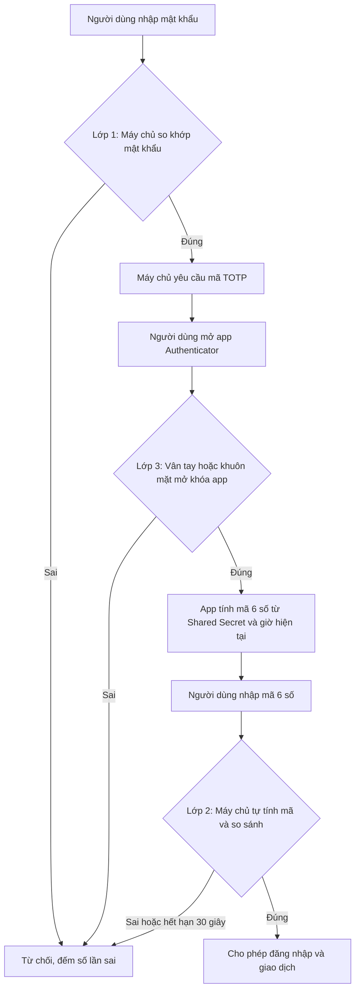

# HỌ VÀ TÊN: **LÂM HỮU NGHỊ**
# LỚP: **HCM_KS26_CNTT1**

## 1. Kiến trúc: 3 lớp bảo vệ

Ba lớp tương ứng 3 loại yếu tố xác thực:

Lớp 1, Something You Know: mật khẩu.
Lớp 2, Something You Have: mã TOTP 6 số sinh từ app Authenticator trên điện thoại.
Lớp 3, Something You Are: vân tay hoặc khuôn mặt, dùng để mở khóa app Authenticator và xác nhận giao dịch.

### Sơ đồ luồng dữ liệu

### Vì sao hacker có mật khẩu vẫn bị chặn

Hacker biết mật khẩu thì qua được lớp 1, nhưng đến lớp 2 chúng cần mã 6 số. Mã này chỉ có trong điện thoại của chủ ví, không truyền qua mạng viễn thông nên không bị nghe lén như SMS. Mã còn đổi mỗi 30 giây, nên có đánh cắp được một mã cũng hết hạn rất nhanh. Dù hacker lấy được cả điện thoại, chúng vẫn bị chặn ở lớp 3 vì không có vân tay hay khuôn mặt của chủ ví. Ba lớp thuộc ba loại khác nhau nên phá một lớp không kéo theo hai lớp còn lại.

## 2. Xử lý Edge Case: người dùng trên máy bay

Lấy mã OTP vẫn được khi không có internet hay sóng điện thoại. Thuật toán TOTP chỉ cần hai thứ đều có sẵn trong điện thoại:

1. Shared Secret: khóa bí mật được lưu vào app khi quét mã QR lúc cài đặt lần đầu.
2. Giờ hiện tại: lấy từ đồng hồ của điện thoại, vẫn chạy khi bật chế độ máy bay.

App chia thời gian thành các khoảng 30 giây, trộn với Shared Secret bằng hàm băm HMAC rồi lấy 6 chữ số. Máy chủ tính theo cùng cách nên hai mã trùng nhau, không cần trao đổi gì qua mạng.

Lưu ý quan trọng: lấy được mã OTP offline không có nghĩa là gửi được giao dịch offline. Việc gửi giao dịch lên mạng blockchain vẫn cần kết nối. Có hai cách xử lý:

Dùng Wi-Fi trên máy bay (nếu hãng bay), rồi nhập mã OTP lấy từ app như bình thường.
Nếu không có Wi-Fi, chờ hạ cánh có mạng rồi mới gửi giao dịch. Mã phải lấy lúc đó, vì mã cũ đã hết hạn.

Hai điều kiện để mã đúng: đồng hồ điện thoại phải chính xác (nên bật tự động cập nhật giờ trước chuyến bay), và đã cài sẵn app cùng Shared Secret từ trước khi lên máy bay. Máy chủ nên chấp nhận lệch một khoảng 30 giây để bù sai số nhỏ của đồng hồ.

Nếu mất điện thoại hoặc hỏng máy giữa chuyến đi, người dùng dùng một trong 10 Mã Khôi phục (Backup Codes) đã cất ở nơi an toàn, mỗi mã chỉ dùng một lần.